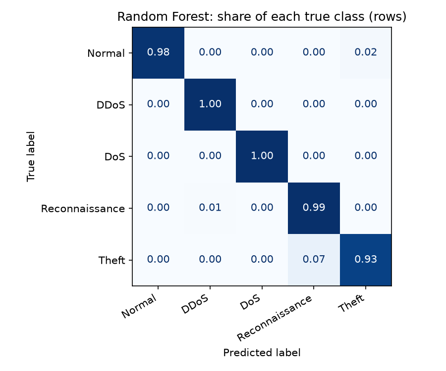

# IoT Botnet Detection: an honest evaluation on Bot-IoT

[](https://github.com/charithareddymr/iot-botnet-detection/actions/workflows/ci.yml)

Detecting DDoS, DoS, reconnaissance and data-theft attacks in IoT network traffic, comparing **Random Forest, AdaBoost, KNN, MLP and an LSTM** on the [Bot-IoT dataset](https://research.unsw.edu.au/projects/bot-iot-dataset).

The focus is not a high score but a **trustworthy** one. Two problems make headline numbers on this dataset misleading, and this project measures both:

1. **Extreme class imbalance.** Only 370 of 2.9 million training rows are normal traffic. A model that always answers "attack" scores **99.985% accuracy** while recognising none of the normal flows.
2. **Data leakage.** A Random Forest given **only the row ID** (`pkSeqID`), with no information about network traffic at all, scores a "perfect" **1.000 balanced accuracy**.

After removing identifier columns and evaluating with imbalance-aware metrics, **Random Forest** is the best detector: **0.979 balanced accuracy, 0.957 macro F1**, 99.998% of attacks detected, trained in 3 seconds.

---

## Key finding: identifiers inflate results to "perfect"

Random Forest, retrained four ways and evaluated on the same untouched test set ([`src/ablation.py`](src/ablation.py)):

| Experiment | Balanced acc. | Macro F1 | False-positive rate | What the model relied on most |
|---|---|---|---|---|
| **A. Behavioural features** (used for all results below) | 0.979 | 0.957 | 1.87% | `srate`, `N_IN_Conn_P_DstIP`, `stddev` |
| B. Behavioural + identifiers | **1.000** | 0.992 | 0.00% | **`pkSeqID`**, `dport`, `daddr` |
| C. **Row ID only** | **1.000** | **0.999** | 0.00% | `pkSeqID` (100%) |
| D. Without whole-capture connection counts | 0.862 | 0.764 | **21.50%** | `srate`, `max`, `stddev` |

- **C** shows the row numbering alone separates the classes, so near-perfect scores that keep identifiers are measuring the dataset's construction, not attack detection.
- **D** shows much of the remaining signal comes from two features counted over the **whole capture** (connections per source and destination IP). A real-time detector would not have these totals up front, and without them the false-positive rate rises from 1.87% to 21.5%.

---

## Method

**Data.** The authors' 5% extract with the "10-best features" and their official train/test split: 2,934,817 training rows and 733,705 test rows. Classes are Normal, DDoS, DoS, Reconnaissance and Theft.

**Leakage screening** ([`src/explore.py`](src/explore.py)). Each column was tested alone with a small decision tree. Identifier-like columns were removed: row ID (`pkSeqID`), IP addresses (`saddr`, `daddr`), ports (`sport`, `dport`) and the Argus record sequence number (`seq`). The models learn from **14 behavioural features**: packet-rate statistics, connection counts, flow state and protocol. The full screening output is in [`reports/data_summary.md`](reports/data_summary.md).

**Imbalance.** The training data only is rebalanced: classes above 50,000 rows are sampled down to 50,000, and Normal and Theft are oversampled to 5,000. **The test set is never touched**, so evaluation reflects the real class mix.

**Metrics.** Accuracy is reported but not trusted. Models are compared on:
- **Balanced accuracy** and **macro F1**: every class counts equally.
- **False-positive rate**: the share of normal traffic wrongly flagged as an attack (alert fatigue).
- **Attack detection rate**: the share of attacks flagged as any attack.

---

## Results

All five models, same features, same untouched test set ([`reports/results.md`](reports/results.md)):

| Model | Accuracy | Balanced acc. | Macro F1 | False-positive rate | Attack detection | Train time |
|---|---|---|---|---|---|---|
| **Random Forest** | 0.9962 | **0.9793** | **0.9568** | **1.87%** | **99.9977%** | 3 s |
| KNN | 0.9891 | 0.9742 | 0.9169 | 2.80% | 99.9950% | <1 s |
| AdaBoost | 0.8986 | 0.9362 | 0.8803 | 1.87% | 99.9926% | 56 s |
| MLP | 0.9591 | 0.9454 | 0.7695 | 3.74% | 99.9885% | 14 s |
| RNN (LSTM) | 0.8951 | 0.9318 | 0.5233 | 2.80% | 99.7718% | 46 s |

Recall per class (share of each class correctly identified):

| Model | Normal | DDoS | DoS | Reconnaissance | Theft |
|---|---|---|---|---|---|
| Random Forest | 0.981 | 0.995 | 0.998 | 0.994 | 0.929 |
| KNN | 0.972 | 0.986 | 0.992 | 0.992 | 0.929 |
| AdaBoost | 0.981 | 0.975 | 0.804 | 0.992 | 0.929 |
| MLP | 0.963 | 0.939 | 0.981 | 0.987 | 0.857 |
| RNN (LSTM) | 0.972 | 0.875 | 0.914 | 0.969 | 0.929 |



**Observations**

- **Accuracy misleads.** Random Forest's 99.62% accuracy is *lower* than the always-attack baseline (99.985%), yet it is by far the better detector.
- **Missed attacks hide in macro F1.** The LSTM labels about 0.23% of attacks as normal: roughly 1,670 flows, against only 107 genuinely normal test flows. Its recall looks fine, but when it says "normal" it is usually wrong, which is why its macro F1 is 0.52. Random Forest mislabels about 17.
- **AdaBoost confuses DoS with DDoS** (0.804 DoS recall); single-source and multi-source floods look alike flow by flow.
- **The deep sequence model adds nothing here.** Flow features are 14 measurements of one flow, not a time series; the LSTM reads them as a sequence to test whether that helps. It is slower and less accurate than Random Forest.

---

## Limitations

- **Tiny normal class.** The test set has only 107 normal flows, so a 1.87% false-positive rate is 2 flows; one more error moves it by about 1%. Theft has only 65 training rows.
- **Lab traffic, not production.** Bot-IoT was recorded in a testbed where attacks vastly outnumber normal traffic. Real networks are the opposite: a 1.87% false-positive rate on millions of normal flows would mean thousands of false alarms a day.
- **Whole-capture aggregates.** The best results depend on connection counts computed over the entire capture (experiment D). A deployable detector would need these computed over a sliding time window.
- **Single random seed** and no hyperparameter tuning; numbers may shift slightly between runs.

---

## Run it

Requires Python 3.10+.

```bash
git clone https://github.com/charithareddymr/iot-botnet-detection.git
cd iot-botnet-detection
python3 -m venv .venv && source .venv/bin/activate
pip install -r requirements.txt
```

Download the two CSVs from the [UNSW Bot-IoT page](https://research.unsw.edu.au/projects/bot-iot-dataset) (Dataset → 5% → 10-best features → 10-best Training-Testing split) into `data/`:
`UNSW_2018_IoT_Botnet_Final_10_best_Training.csv` and `UNSW_2018_IoT_Botnet_Final_10_best_Testing.csv`.

```bash
python -m src.explore      # class balance + single-feature leakage screening
python -m src.train        # Random Forest, AdaBoost, KNN, MLP
python -m src.train_rnn    # LSTM (needs PyTorch)
python -m src.ablation     # leakage experiment
python -m pytest -v        # tests (no dataset needed)
```

## Project structure

```
src/
  explore.py      data summary, accuracy trap, single-feature leakage test
  features.py     leakage-safe features, train-only rebalancing
  train.py        four scikit-learn models + imbalance-aware evaluation
  train_rnn.py    LSTM in PyTorch, same data and evaluation
  ablation.py     identifier / row-ID / no-aggregate experiments
tests/            pipeline and metric tests on synthetic data
reports/          results tables, confusion matrices, data summary
```

## Background and data credit

This is an independent 2026 rebuild of a topic from my undergraduate team project (B.Tech, 2022). All code and analysis in this repository are new.

The Bot-IoT dataset is by N. Koroniotis, N. Moustafa, E. Sitnikova and B. Turnbull, "Towards the development of realistic botnet dataset in the Internet of Things for network forensic analytics: Bot-IoT dataset", *Future Generation Computer Systems* 100 (2019): 779–796. It is free for academic use; the data files are not redistributed here.

## License

MIT
